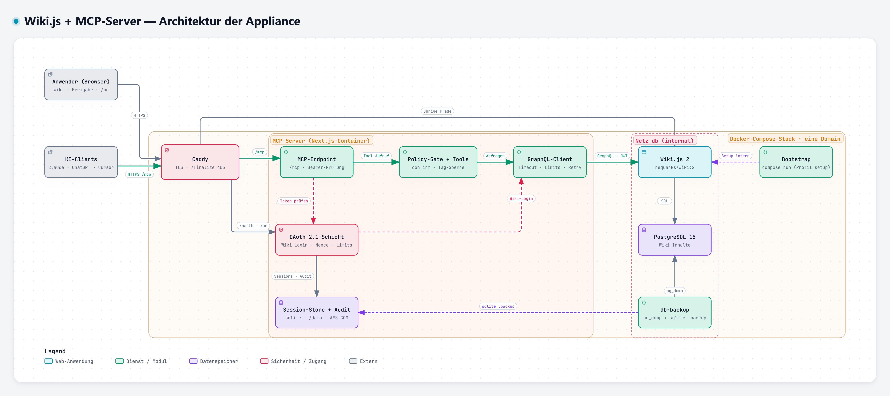

# mcp-wikijs-mv

> 🇬🇧 English version: [README.en.md](README.en.md)

Ein **MCP-Server für [Wiki.js](https://js.wiki/)** mit drei Zielen:

1. **Möglichst vollständige Abdeckung der GraphQL-API** — **70 Tools** über alle Domänen (Pages, Tags, Assets inkl. Datei-Upload **und -Download**, Users, Groups, Comments, Navigation, Auth/API-Keys, Site/System), inklusive eines `wiki_graphql`-Escape-Hatch für 100 % Abdeckung.
2. **Feingranulare Rechtesteuerung** — pro Funktion/Kategorie: _erlaubt_ / _nur mit Genehmigung_ / _geblockt_.
3. **Echter Mehrbenutzer-Betrieb** — jeder Nutzer mit eigenem API-Key/eigenen Rechten, **ohne** dass der echte Wiki.js-Key zum LLM-Anbieter (ChatGPT/Claude) gelangt.

Läuft in zwei Modi aus **einem** Code:

| Modus | Transport | Einsatz | Auth |
|---|---|---|---|
| **HTTP** | Streamable HTTP (`/mcp`) | **Docker/Self-hosted** (empfohlen) oder Vercel | **OAuth mit Wiki.js-Login** (empfohlen) oder pro Request (Header/URL-Param) |
| **stdio** | stdio | lokal (Claude Desktop, Cursor) | aus Env |

**Neu: OAuth-Modus (self-hosted).** Mit gesetztem `MCP_SESSION_SECRET` verbinden sich alle Clients
(claude.ai, Claude Code, ChatGPT/Codex, Cursor) über **eine geheimnislose URL** (`https://<host>/mcp`);
der Autorisierungs-Schritt ist der normale **Wiki.js-Login** (Ein-Klick bei bestehender Wiki-Sitzung
auf derselben Domain). Jede Session agiert mit den echten Rechten **dieses Wiki-Users** (Gruppen +
Page-Rules, durchgesetzt von Wiki.js selbst); der MCP-Server behält nur die Agenten-Schutzschicht
(`confirm`-Gates, Tag-Guardrail). Selbstverwaltung unter **`/me`** (Verbindungen ansehen/widerrufen).
Details: [docs/oauth.md](docs/oauth.md) · Komplett-Stack: `docker-compose.yml` im Repo-Root.

---

## Inhalt

**Empfohlen (OAuth-Betrieb):**
- [Deployment, Ersteinrichtung & Client verbinden → Root-README](../README.md)  ← **hier anfangen**
- [Konzept & Rechtemodell](docs/konzept-ki-zugang.md) · [OAuth-Technik](docs/oauth.md)
- [Funktionen](#funktionen) · [Tool-Übersicht](#tool-übersicht) · [Architektur](#architektur) · [Robustheit](#robustheit) · [Tests](#tests) · [Grenzen](#grenzen)

**Legacy-Fallback (ohne OAuth — Vercel/Serverless/stdio):**
- [Schnellstart (lokale Entwicklung)](#schnellstart)
- [Auf Vercel deployen + Umgebungsvariablen](#auf-vercel-deployen--umgebungsvariablen)
- [Mehrbenutzer: Profile & Handle-Generierung](#mehrbenutzer-profile--handle-generierung)
- [Clients verbinden (Legacy): ChatGPT & Claude Code](#clients-verbinden-chatgpt--claude-code)
- [Rechtesteuerung (Legacy-Rollen)](#rechtesteuerung-permission-policy)

---

## Funktionen

- **Volle GraphQL-API** — 70 Tools: Pages-CRUD, Tree/History/Version/Links/Search/Tags, Batch- & Tree-Delete, Assets (inkl. Download), Users, Groups, Comments, Navigation, API-Keys, Site/System + Raw-GraphQL.
- **OAuth mit Wiki.js-Login (empfohlen)** — eine geheimnislose URL für alle; jede Session trägt den **User-JWT** der Person, Wiki.js erzwingt deren Rechte. Keine doppelte User-Pflege.
- **Agenten-Schutz** — Dry-Run-`confirm` vor destruktiven Aktionen und Tag-Sperre (`WIKIJS_BLOCKED_TAGS`, z. B. `kein-ki`), die Seiten für KI unsichtbar/unantastbar macht.
- **Selbstverwaltung** — `/me`: eigene KI-Verbindungen ansehen/widerrufen; Admins sehen alle Sessions + Audit-Log.
- **Robust** — Concurrency-Gate, Request-Timeout, Auto-Preserve bei Updates, Content-Truncation, Session-Auto-Cleanup, Graceful Shutdown.
- **Legacy-Fallback** — Vercel/Serverless via [`mcp-handler`](https://github.com/vercel/mcp-handler) mit Handle-/BYOK-/stdio-Auth bleibt möglich (eingefroren; Abschnitte unten).

---

## Schnellstart

**Production:** Der empfohlene Weg ist die **Docker-Appliance mit OAuth** —
Deployment, Ersteinrichtung und Client-Verbindung stehen im
[Root-README](../README.md). Dieser Abschnitt hier ist nur die lokale
Entwicklung des Servercodes.

```bash
cd mcp-for-wiki-js
npm install
npm run dev           # lokal als HTTP-Server: http://localhost:3030/mcp
npm run stdio         # lokal als stdio-Server (Claude Desktop / Cursor), Creds aus .env
```

Für OAuth lokal genügt `MCP_SESSION_SECRET` + `WIKIJS_URL` (siehe
[docs/oauth.md](./docs/oauth.md)). Die Abschnitte unten (Vercel, Profile &
Handle, Rollen) beschreiben den **Legacy-Fallback-Betrieb** — für neue
Deployments nicht nötig.

---

<a id="legacy"></a>
> ## ⚙️ Ab hier: Legacy-Fallback-Betrieb (ohne OAuth)
> Alles Folgende — Vercel-Deploy, `WIKIJS_TOKEN`/`WIKIJS_PROFILES`-Handles, die
> MCP-Rollenleiter — gilt **nur**, wenn OAuth aus ist (kein
> `MCP_SESSION_SECRET`), etwa auf Vercel/Serverless. Im OAuth-Betrieb kommen
> Identität und Rechte aus Wiki.js; diese Mechaniken sind dort ohne Funktion,
> bleiben aber als eingefrorener Fallback erhalten.

---

## Auf Vercel deployen + Umgebungsvariablen

### Grundsatz: zum Deployen brauchst du **keine** Env-Variable
Der Build (`next build`) läuft ohne jede Env. **Was** du setzt, entscheidet nur den Betriebsmodus:

| Modus | Env setzen | Nutzer geben… |
|---|---|---|
| **Single-Tenant** — eine feste Instanz für alle | `WIKIJS_URL` + `WIKIJS_TOKEN` (+ optional `WIKIJS_PERMISSION_PRESET`) | nichts (nur die URL `…/mcp`) |
| **Mehrbenutzer (empfohlen)** — viele Nutzer, je eigener Key/Rechte | `WIKIJS_PROFILES` (+ optional `WIKIJS_PERMISSION_PRESET`) | ihren geheimen **Handle** |

Im Mehrbenutzer-Modus liegen die echten Keys **als Env-Variable in Vercel** (Vercel verschlüsselt Env at-rest) — der LLM-Anbieter sieht nur den Handle. Details: [Profile & Handle](#mehrbenutzer-profile--handle-generierung).

### Vollständige Env-Referenz

| Variable | Pflicht | Default | Zweck |
|---|---|---|---|
| `WIKIJS_URL` | ja (OAuth, Single-Tenant)¹ | – | Adresse, unter der der MCP-Server das Wiki erreicht (ohne `/graphql`). Hostname/Domain oder IP, intern oder öffentlich: z. B. `http://wiki:3000` (Docker), `http://wiki.ns.svc:3000` (Kubernetes) oder `https://wiki.example.org`. Für Domains mit firmeninternem Zertifikat siehe `NODE_EXTRA_CA_CERTS` |
| `WIKIJS_BASE_URL` | nein | – | Alias für `WIKIJS_URL` (ältere Konfigurationen) |
| `WIKIJS_TOKEN` | nur Single-Tenant¹ | – | Wiki.js-API-Key (Bearer). **Secret.** (Alias: `WIKIJS_API_KEY`). Geht nur an `WIKIJS_URL`, nie an eine vom Aufrufer gewählte URL. Sind `WIKIJS_PROFILES` oder `WIKIJS_KEY_MAP` gesetzt, bekommen anonyme HTTP-Aufrufer ihn **nicht** |
| `WIKIJS_PROFILES` | für Mehrbenutzer | – | JSON: geheimer Handle → `{ label, token, role, url? }`. **Secret.** Siehe [unten](#mehrbenutzer-profile--handle-generierung) |
| `WIKIJS_PERMISSION_PRESET` | nein | `safe` (Compose/Helm: `full`) | **Globale Obergrenze** (Ceiling-Rolle) — sichtbare Tools + Maximum. Rollen in `config/roles.json` |
| `WIKIJS_POLICY` | nein | – | JSON-Feinjustierung deploy-weit pro Kategorie/Tool |
| `WIKIJS_ROLES` | nein | – | JSON, das die **Rollen-Definitionen** zur Laufzeit überschreibt (Form wie `config/roles.json`) |
| `WIKIJS_SHOW_BLOCKED` | nein | `false` | geblockte Tools als deaktivierte Stubs in `tools/list` zeigen |
| `WIKIJS_ALLOWED_URLS` | nein | – | Kommaliste erlaubter Wiki-Origins für `X-Wikijs-Url`/`?url=` (nur mit eigenem BYOK-Key; serverseitige Keys gehen immer nur an `WIKIJS_URL`). Ohne Liste wird eine Client-URL nur akzeptiert, wenn sie `WIKIJS_URL` entspricht oder kein `WIKIJS_URL` gesetzt ist (reiner Multi-Tenant-BYOK). Im reinen BYOK werden interne Ziele abgelehnt — IP-Literale (Loopback, private Netze, Link-Local, Multicast, reservierte Bereiche, auch IPv4 in IPv6 verpackt) und interne Namen (ohne Punkt, `localhost`, `*.local`, `*.internal`); vor **jedem** Request prüft der Server zusätzlich alle aufgelösten Adressen des Namens. Ein internes Wiki dort über diese Liste freigeben. Grenze: DNS-Rebinding zwischen Prüfung und Verbindungsaufbau ist nicht abgedeckt (Startwarnung „reines BYOK“) |
| `WIKIJS_ALLOW_LEGACY` | nein | `false` | Nur mit OAuth relevant: `true` öffnet zusätzlich den Legacy-Weg (BYOK-Key/Handle per Header oder URL). Standardmäßig aus — der Legacy-Handler hat keine eigene Anmeldung |
| `WIKIJS_KEY_MAP` | nein | – | Legacy-Map Handle→Token (nur Token; Policy aus Env). Die Keys gehen nur an `WIKIJS_URL` (ohne `WIKIJS_URL` sind die Aliase unbrauchbar). Von `WIKIJS_PROFILES` abgelöst |
| `WIKIJS_TIMEOUT_MS` | nein | `30000` | Timeout pro GraphQL-Request inkl. Lesen der Antwort (AbortController) |
| `WIKIJS_MAX_CONCURRENCY` | nein | `8` (Compose: `12`) | Max. parallele Upstream-Requests **pro Wiki** (Overload-Schutz; queued/sheddet bei Überlast) |
| `WIKIJS_RETRIES` | nein | `2` | Wiederholungen bei Verbindungsfehlern und Proxy-502/503/504: Lesezugriffe immer, Mutationen nur, wenn der Request sicher nicht gesendet wurde; insgesamt höchstens eine Timeout-Dauer. `0` = aus |
| `WIKIJS_MAX_RESPONSE_BYTES` | nein | `16777216` (16 MiB) | Obergrenze für eine GraphQL-Antwort (min. `1024`); größere Antworten werden abgebrochen |
| `WIKIJS_AUDIT` | nein | `true` | Audit-Log für write/delete/admin (`false` = aus; nie Secrets) |
| `WIKIJS_MCP_VERBOSE` | nein | `false` | MCP-Request-Logging (`true`) |
| `PUBLIC_BASE_URL` | mit OAuth hinter Proxy: ja | aus `X-Forwarded-*` | Öffentliche Adresse des MCP-Servers (OAuth-Issuer, Connector-URL, Discovery) — dieselbe Domain wie das Wiki, damit die Wiki-Sitzung den Login zum Ein-Klick macht |
| `MCP_SESSION_SECRET` | für OAuth | – | Schaltet OAuth ein (Login = Wiki.js-Login) und verschlüsselt den Session-Store. Mind. 16 Zeichen, sonst startet der Server nicht; unter 32 Zeichen warnt er beim Start (zufällige Bytes nehmen, z. B. `openssl rand -base64 48`). **Secret** |
| `MCP_DATA_DIR` | nein | `./data` (Docker: `/data`) | Ablage des Session-Stores und Audit-Logs (sqlite) — muss ein persistentes Volume sein |
| `WIKIJS_OAUTH_ROLE` | nein | `wiki` | Agenten-Schutzrolle für OAuth-Sitzungen (Rolle aus `config/roles.json`); die eigentlichen Rechte kommen aus Wiki.js |
| `MCP_ALLOWED_REDIRECT_HOSTS` | nein | – (jeder https-Host) | Kommaliste von Hostnamen, an die OAuth-Clients weiterleiten dürfen (z. B. `claude.ai,chatgpt.com`); Loopback ist immer erlaubt. Leer bei aktivem OAuth → Startwarnung, weil dann jeder Client per Phishing-Link ein Token für ein fremdes Wiki-Konto erhalten könnte |
| `NODE_EXTRA_CA_CERTS` | nein | – | Node-Standardvariable: Pfad zu einer PEM-Datei mit zusätzlichen Zertifizierungsstellen. Nötig, wenn `WIKIJS_URL` eine Domain mit firmeninternem Zertifikat ist (Datei in den Container mounten) |
| `TZ` | nein | `UTC` (Container) | Zeitzone der Zeitangaben auf `/me`, z. B. `Europe/Berlin` |

¹ Im Mehrbenutzer-Modus liefern die `WIKIJS_PROFILES`-Einträge den Token; die URL kommt aus `WIKIJS_URL` (oder dem optionalen `url` im Profil). `WIKIJS_TOKEN` ist dann **kein** Fallback für Aufrufer ohne Handle. Auf der **stdio**-Variante (lokal, ein Nutzer) sind `WIKIJS_URL` + `WIKIJS_TOKEN` Pflicht; stdio nutzt immer `WIKIJS_TOKEN`.

Ungültige Werte für `WIKIJS_TIMEOUT_MS`, `WIKIJS_MAX_CONCURRENCY`, `WIKIJS_RETRIES` und `WIKIJS_MAX_RESPONSE_BYTES` (keine ganze Zahl oder unter dem Minimum) fallen auf den Default zurück.

### Env in Vercel setzen
**Dashboard:** Projekt → **Settings → Environment Variables** → pro Variable **Name** + **Value** → Environment **Production** (gern auch **Preview**) anhaken → **Save**.

**CLI:**
```bash
vercel env add WIKIJS_PROFILES production
vercel env add WIKIJS_PERMISSION_PRESET production
```

> ⚠️ **Nach jeder Env-Änderung neu deployen** (Deployments → ⋯ → Redeploy, bzw. `vercel --prod`), sonst greifen die Werte nicht.

### Sicherheit
- `WIKIJS_TOKEN`, `WIKIJS_PROFILES`, `WIKIJS_KEY_MAP` sind **Secrets** — als normale Env-Variable eintragen (Vercel verschlüsselt at-rest), **nie** ins Repo committen (`.env` ist in `.gitignore`).
- **Scoped Keys** verwenden (read-only/gruppenbeschränkt) + sinnvolles `WIKIJS_PERMISSION_PRESET` → Defense-in-Depth.
- **Reines BYOK** (weder `WIKIJS_URL` noch `WIKIJS_ALLOWED_URLS`, kein OAuth): Aufrufer bestimmen das Ziel-Wiki. Interne Ziele werden abgelehnt, die aufgelösten Adressen vor jedem Request geprüft; ein Name, der genau zwischen Prüfung und Verbindungsaufbau umschwenkt (DNS-Rebinding), kommt aber noch durch. Der Server warnt beim Start. Für eine harte Grenze `WIKIJS_URL` oder `WIKIJS_ALLOWED_URLS` setzen.
- `maxDuration` der MCP-Function ist auf **60 s** gesetzt (läuft auf jedem Plan inkl. Hobby; in `app/[transport]/route.ts` erhöhbar auf Pro).

---

## Mehrbenutzer: Profile & Handle-Generierung

### Konzept
Statt den echten Key an den Client/LLM zu geben, konfigurierst du Nutzer als **Profile** in `WIKIJS_PROFILES` und **weist jedem eine Rolle zu**. Der **Map-Key jedes Profils ist ein geheimer, unerratbarer Handle** — das einzige, was der Nutzer/LLM sieht. Die **Wiki-URL wird einmal global** über `WIKIJS_URL` gesetzt (in der Regel ein Wiki für alle):

```jsonc
"<GEHEIMER-HANDLE>": {
  "label": "Alice",                    // nicht-geheimer Name (Audit/Anzeige)
  "token": "<echter Wiki.js-API-Key>", // Secret — bleibt serverseitig
  "role":  "leser",                    // Rolle aus config/roles.json
  "url":   "https://…"                 // OPTIONAL (selten; Default: WIKIJS_URL)
}
```

- **Jeder Handle = eigener Key + eigene Rolle.** Verschiedene Keys laufen **nie** über denselben Handle.
- `label` wird in `wiki_connection_status` angezeigt; **der geheime Handle wird nie zurückgegeben**.
- Echte Rechte = Wiki.js-Key **und** Rolle (MCP-Schranke). Die Rolle reicht maximal bis zur globalen Obergrenze `WIKIJS_PERMISSION_PRESET` — siehe [Rollen](#rechtesteuerung-rollen).

> ⚠️ **Der Handle IST das Geheimnis.** Wäre er erratbar (z. B. ein Vorname), könnte ein Nutzer den Handle eines anderen verwenden und dessen Rechte erben → Rechtemanagement ausgehebelt. **Immer hochentropische Zufalls-Handles** verwenden — kein Tool außer einem **CSPRNG** ist nötig (kein Online-Generator!).

### Handles erzeugen
**Empfohlen — der mitgelieferte Generator** (`label:role`, gibt die fertige Env-Zeile aus):
```bash
npm run gen:profile -- "Alice:leser" "Bob:redakteur"
```
Ausgabe (Beispiel):
```text
WIKIJS_PROFILES={"wzp_…A":{"label":"Alice","token":"REPLACE_WITH_ALICE_WIKIJS_API_KEY","role":"leser"},"wzp_…B":{"label":"Bob","token":"REPLACE_WITH_BOB_WIKIJS_API_KEY","role":"redakteur"}}

# Jedem Nutzer seinen geheimen Handle aushändigen (wie ein Passwort):
#   Alice [role: leser]     → wzp_…A
#   Bob   [role: redakteur] → wzp_…B
```

**Alternativen (alle lokal, CSPRNG):**
```bash
# Node:
node -e "console.log('wzp_'+require('crypto').randomBytes(24).toString('base64url'))"
# OpenSSL:
echo "wzp_$(openssl rand -base64 24 | tr '+/' '-_' | tr -d '=')"
```
```powershell
# Windows PowerShell (eingebaut):
$b=[byte[]]::new(24);([Security.Cryptography.RNGCryptoServiceProvider]::new()).GetBytes($b);'wzp_'+[Convert]::ToBase64String($b).TrimEnd('=').Replace('+','-').Replace('/','_')
```
Oder ein **Passwort-Manager** (1Password/Bitwarden/KeePass): „langes Zufallspasswort" — erzeugt **und** speichert ihn.

> Der Präfix `wzp_` ist nur Konvention (Wiedererkennung/Secret-Scanning) und weglassbar. **Verboten:** selbst ausgedachte Strings, `Get-Random`, `Math.random()`, Zeitstempel — das sind keine CSPRNGs. Handles **nicht** in einem Online-Tool oder im Chat erzeugen.

### Beispiel: 2 Nutzer auf **derselben** Wiki-URL
1. Generieren: `npm run gen:profile -- "Alice:readonly" "Bob:editor"`
2. Die `REPLACE_WITH_…`-Platzhalter durch echte (scoped) Wiki.js-Keys ersetzen:
```text
WIKIJS_PROFILES={"wzp_…SECRET-A":{"label":"Alice","url":"https://wiki.example.org","token":"<KEY_ALICE>","preset":"readonly"},"wzp_…SECRET-B":{"label":"Bob","url":"https://wiki.example.org","token":"<KEY_BOB>","preset":"editor"}}
```
3. In Vercel als `WIKIJS_PROFILES` setzen (+ z. B. `WIKIJS_PERMISSION_PRESET=editor` als Obergrenze) → **Redeploy**.
4. Jedem Nutzer seinen geheimen Handle geben (siehe [Clients verbinden](#clients-verbinden-chatgpt--claude-code)).

### Widerruf
Eintrag aus `WIKIJS_PROFILES` entfernen → **Redeploy**. (Der Wiki.js-Key selbst kann zusätzlich in Wiki.js widerrufen werden.)

---

## Clients verbinden: ChatGPT & Claude Code

**Welcher Weg geht wo?** Die Clients unterscheiden sich, wie ein Geheimnis übergeben wird:

| Client | Custom-Header? | Handle übergeben via |
|---|---|---|
| **ChatGPT** (Developer Mode) | ❌ | **URL-Parameter** `?token=<handle>` |
| **claude.ai (Web-Connector)** | ❌ | **URL-Parameter** `?token=<handle>` |
| **Claude Code** (CLI) | ✅ | **Header** `X-Wikijs-Token: <handle>` |
| **Cursor** | ✅ | **Header** |
| **Claude Desktop** (lokal) | – | **stdio** mit Env (oder Web-Connector) |

> Bei `WIKIJS_PROFILES` schickt der Client **nur den Handle** als Token — keine URL nötig (die steckt im Profil). Ohne Profile (direktes BYOK) zusätzlich die Instanz-URL mitgeben (`?url=…` bzw. `X-Wikijs-Url`) — ist auf dem Server `WIKIJS_URL` gesetzt, muss die URL ihr entsprechen oder in `WIKIJS_ALLOWED_URLS` stehen. Ohne beides (reiner BYOK) werden interne Adressen und Namen abgelehnt (Loopback, private Netze, `localhost`, `*.internal`, Namen ohne Punkt) — auch wenn erst die DNS-Auflösung eines öffentlich aussehenden Namens auf sie zeigt.

### ChatGPT (Developer Mode → Custom Connector)
Voraussetzung: Plan **Plus/Pro/Business/Enterprise/Edu**; Server über **HTTPS** erreichbar (Vercel ✓).

1. **Settings → Connectors → Advanced settings → Developer mode** aktivieren.
2. **Settings → Connectors → Create** (bzw. „Add custom connector").
3. **MCP Server URL** mit dem geheimen Handle eintragen:
   ```
   https://<deploy>/mcp?token=wzp_DEIN_GEHEIMER_HANDLE
   ```
   (Optional zusätzlich verschärfen: `&preset=readonly`.)
4. **Authentication: No authentication** (das Geheimnis steckt in der URL).
5. Speichern → im Composer den Connector aktivieren.

> Developer Mode gibt vollen Tool-Zugriff inkl. Schreib-Aktionen (mit Bestätigungs-Dialog). Zusätzlich greift die Server-Policy: im Default `safe` liefern Write/Delete zuerst eine Dry-Run-Vorschau (echte Ausführung erst mit `confirm: true`).

### Claude Code (CLI)
Claude Code unterstützt Custom-Header — der Handle bleibt aus der URL heraus:
```bash
claude mcp add --transport http wikijs https://<deploy>/mcp \
  --header "X-Wikijs-Token: wzp_DEIN_GEHEIMER_HANDLE"
```
- Mehrere `--header` möglich (z. B. zusätzlich `--header "X-Wikijs-Preset: readonly"`).
- Scope: `-s local` (Default, nur du) · `-s user` (alle deine Projekte) · `-s project` (eingecheckte `.mcp.json` — **keinen echten Handle committen!**).
- Prüfen: `claude mcp list`, `claude mcp get wikijs`.

Alternativ als JSON (`~/.claude.json` oder Projekt-`.mcp.json`):
```jsonc
{
  "mcpServers": {
    "wikijs": {
      "type": "http",
      "url": "https://<deploy>/mcp",
      "headers": { "X-Wikijs-Token": "wzp_DEIN_GEHEIMER_HANDLE" }
    }
  }
}
```

### claude.ai (Web-Connector) & Cursor
- **claude.ai (Web):** Settings → Connectors → **Add custom connector** → URL `https://<deploy>/mcp?token=<handle>` → Add. (Plan Pro/Max/Team/Enterprise.)
- **Cursor:** `.cursor/mcp.json` mit `url` + `headers: { "X-Wikijs-Token": "<handle>" }`.

### Claude Desktop (lokal, stdio)
Single-User über die `.env` des Servers (kein Handle nötig):
```jsonc
{
  "mcpServers": {
    "wikijs": {
      "command": "npm",
      "args": ["--prefix", "/ABSOLUTER/PFAD/zu/mcp-wikijs-mv", "run", "stdio"],
      "env": {
        "WIKIJS_URL": "https://dein-wiki.example.org",
        "WIKIJS_TOKEN": "DEIN_WIKIJS_API_KEY",
        "WIKIJS_PERMISSION_PRESET": "editor"
      }
    }
  }
}
```

### Verbindung testen
Im Client das Tool **`wiki_connection_status`** aufrufen lassen → zeigt `connected`, `baseUrl`, `profile` (= Label) und ob ein Key gesetzt ist. Bei `connected: true` passt alles.

---

## Rechtesteuerung (Rollen)

Jedes Tool hat eine **Kategorie**; eine **Rolle** bildet jede Kategorie (und optional jedes Tool) auf einen **Modus** ab:

| Modus | Verhalten |
|---|---|
| `allow` | wird sofort ausgeführt |
| `confirm` | gibt zunächst eine **Dry-Run-Vorschau** zurück; echte Ausführung erst mit `confirm: true` |
| `block` | in `tools/list` ausgeblendet (oder verweigert die Ausführung) |

**Kategorien:** `read`, `write`, `delete`, `manage_users`, `manage_groups`, `manage_system`, `manage_auth`.

> `confirm` ist eine **Bremse, keine menschliche Freigabe**: das Modell setzt `confirm: true` selbst. Alle Tools haben das Feld, auch Lese-Tools (`read: confirm` funktioniert). Die Vorschau schwärzt Passwörter/Secrets/Tokens und kürzt `contentBase64`.

### Rollen-Leiter (`config/roles.json`)
Rollen sind in [`config/roles.json`](./config/roles.json) definiert — frei editierbar, mit `extends` (Vererbung) und **per-Tool**-Overrides. Default-Leiter:

| Rolle | read | write | delete | users | groups | system | auth | Hinweis |
|---|---|---|---|---|---|---|---|---|
| `leser` | allow | block | block | block | block | block | block | nur lesen |
| `kommentator` | allow | block | block | block | block | block | block | + nur Kommentare schreiben (per-Tool) |
| `autor` | allow | allow | block | block | block | block | block | schreiben, nicht löschen |
| `redakteur` | allow | allow | confirm | block | block | block | block | = `editor` |
| `moderator` | allow | allow | confirm | confirm | block | block | block | + Nutzer moderieren |
| `betreuer` | allow | allow | confirm | block | block | confirm | block | + Wartung (Cache/Tree) |
| `admin` | allow | allow | confirm | confirm | confirm | confirm | block | + Nutzer/Gruppen |
| `systemadmin` | allow | allow | allow | allow | allow | allow | allow | = `full` |

(Plus Kompat-Aliase `readonly`/`safe`/`editor`/`maintainer`/`full`.) Effektive Rollen anzeigen: **`npm run roles`**. **Vollständige Matrix + Klartext-Beschreibung: [docs/roles.md](./docs/roles.md).**
Eigene Rolle anlegen: Eintrag in `config/roles.json` (oder `extends` einer bestehenden) → Vercel **Redeploy**, bzw. ohne Rebuild per Env `WIKIJS_ROLES` (gleiches JSON).

### Obergrenze, Zuweisung & Verschärfung
- **Globale Obergrenze** (`WIKIJS_PERMISSION_PRESET`): die **maximale** Capability + der **sichtbare** Tool-Satz. Auf deine **höchste** verwendete Rolle setzen.
- **Pro Person** (`role` im `WIKIJS_PROFILES`-Eintrag): die zugewiesene Rolle — wirkt **innerhalb** der Obergrenze.
- **Pro Request** (Client): Header `X-Wikijs-Preset` / `X-Wikijs-Policy` bzw. URL `&preset=` / `&policy=` — nur **verschärfend**. Beide wirken auch zusammen und auch in OAuth-Sitzungen.

> **Sicherheitsmodell:** Rolle & Request-Overlay können nur **bis zur Obergrenze** reichen und nur **verschärfen**. Die **Sichtbarkeit** in `tools/list` bestimmt die Obergrenze (mcp-handler registriert global). Echte Rechte = Schnittmenge aus Wiki.js-Key und Rolle.

---

## Tool-Übersicht

`wiki_`-Präfix. (R)=read · (W)=write · (D)=delete · (S)=manage_system · (U)=manage_users · (G)=manage_groups · (A)=manage_auth.

**Pages / Tags** `wiki_pages_search` (R) · `wiki_page_get` (R) · `wiki_pages_list` (R) · `wiki_pages_tree` (R) · `wiki_page_history` (R) · `wiki_page_version` (R) · `wiki_pages_links` (R) · `wiki_tags_list` (R) · `wiki_tags_search` (R) · `wiki_page_create` (W) · `wiki_page_update` (W, full **oder** `edits=[{find,replace}]`) · `wiki_page_move` (W) · `wiki_page_restore` (W) · `wiki_page_convert` (W) · `wiki_page_delete` (D) · `wiki_pages_delete_batch` (D) · `wiki_pages_delete_tree` (D) · `wiki_page_render` (S) · `wiki_tag_update` (S) · `wiki_tag_delete` (S) · `wiki_pages_purge_history` (S, `olderThan` als ISO-8601-Dauer > 0, z. B. `P30D`) · `wiki_pages_flush_cache` (S) · `wiki_pages_rebuild_tree` (S) · `wiki_pages_migrate_locale` (S)

**Assets** `wiki_assets_list` (R) · `wiki_asset_folders` (R) · `wiki_asset_download` (R) · `wiki_asset_upload` (W) · `wiki_asset_create_folder` (W) · `wiki_asset_rename` (W) · `wiki_asset_delete` (D) · `wiki_assets_flush_temp` (S)

**Comments** `wiki_comments_list` (R) · `wiki_comment_get` (R) · `wiki_comment_create` (W) · `wiki_comment_update` (W) · `wiki_comment_delete` (D)

**Navigation** `wiki_navigation_get` (S) · `wiki_navigation_update_tree` (S, lehnt `javascript:`/`vbscript:`/`data:`-Links ab)

**Users** `wiki_user_profile` (R) · `wiki_users_list` · `wiki_users_search` · `wiki_user_get` · `wiki_users_last_logins` · `wiki_user_create` · `wiki_user_update` · `wiki_user_delete` · `wiki_user_activate` · `wiki_user_deactivate` · `wiki_user_verify` · `wiki_user_reset_password` · `wiki_user_disable_tfa` (U, außer Profile)

**Groups** `wiki_groups_list` · `wiki_group_get` · `wiki_group_create` · `wiki_group_update` · `wiki_group_delete` · `wiki_group_assign_user` · `wiki_group_unassign_user` (G)

**System / Auth / Escape-Hatch** `wiki_connection_status` (R) · `wiki_site_info` (R) · `wiki_site_config` (S) · `wiki_system_info` (S) · `wiki_system_flags` (S) · `wiki_apikeys_list` (A) · `wiki_apikey_create` (A) · `wiki_apikey_revoke` (A) · `wiki_auth_strategies` (A) · `wiki_auth_set_api_state` (A) · `wiki_graphql` (S, beliebige GraphQL-Operation)

**Lese-Tools in `manage_*`** (`wiki_users_list`, `_search`, `wiki_user_get`, `wiki_users_last_logins`, `wiki_groups_list`, `wiki_group_get`, `wiki_navigation_get`, `wiki_site_config`, `wiki_system_info`, `wiki_system_flags`, `wiki_apikeys_list`, `wiki_auth_strategies`) tragen `readOnlyHint` und erzeugen keinen Audit-Eintrag; ihr Policy-Modus bleibt der ihrer Kategorie.

**Parameter mit eigenem Gate:** `scriptJs`/`scriptCss` bei `wiki_page_create`/`_update` brauchen den Modus von `manage_system` (Policy-Schlüssel `wiki_page_scripts`, per Tool-Override steuerbar): `block` → Fehler, `confirm` → Vorschau. `groups` bei `wiki_user_create`/`_update` braucht den Modus von `wiki_group_assign_user`. Ebenso Passwort, E-Mail und 2FA eines **privilegierten** Kontos (Administratoren-Gruppe oder eine Gruppe mit `manage:system`/`manage:users`/`manage:groups`/`manage:api`/`write:users`/`write:groups`) über `wiki_user_update`, `wiki_user_reset_password` und `wiki_user_disable_tfa`. `wiki_apikey_create` mit `fullAccess` oder `group: 1` läuft nur bei `manage_auth` = `allow` (keine Selbstbestätigung).

**Geschwärzt** werden in Vorschauen und `wiki_graphql`-Ergebnissen Felder wie `password`, `passwd`, `secret`, `token`, `privateKey`, `apiKey`, `credential`, `jwt` sowie der `value` von `{ key, value }`-Paaren mit solchem Schlüssel.

**Massenlöschen** (`wiki_pages_delete_batch`, `wiki_pages_delete_tree`): `pathPattern` mit `*`/`?` innerhalb eines Pfadsegments, `**` über beliebige Tiefe (`drafts/*` = direkte Kinder, `drafts/**` = alles darunter). `locale` gilt für `paths`, `pathPattern` und den Tree; `ids` gelten locale-übergreifend. Höchstens 1000 `ids` bzw. `paths` pro Aufruf; mehr als 50 Ziele nur mit `force: true`. Die `confirm`-Vorschau zeigt die tatsächlich betroffenen Seiten (Anzahl + bis zu 100 Pfade). Ergebnis-Pfade als `locale/pfad`; nicht gefundene `ids`/`paths` stehen in `notFound`.

**Locale und Listen:** Ohne `locale` nutzen die Tools die Standardsprache des Wikis (Admin → Locale), nicht mehr fest `en`. `wiki_pages_list` liefert ohne `limit` die ersten 100 Seiten, `wiki_users_list` die ersten 100 Konten, `wiki_pages_links` die ersten 500 Einträge; ist mehr vorhanden, steht ein Hinweis im Ergebnis.

**Wiki.js-Eigenheiten:** `wiki_page_restore` entfernt in Wiki.js alle Tags der Seite; das Ergebnis nennt sie (`tagsRemoved`), damit sie per `wiki_page_update` zurückgesetzt werden können. Kommentare gesperrter Seiten (`WIKIJS_BLOCKED_TAGS`) sind auch über ihre ID nicht lesbar, änderbar oder löschbar.

Mehr zu den Admin-Domänen (Theming/Storage/Mail/Search/…): [docs/admin-extension.md](./docs/admin-extension.md).

---

## Architektur



Interaktiv mit Quellenverweisen je Komponente: [docs/architektur.html](./docs/architektur.html). Modulübersicht:

```
app/[transport]/route.ts           Streamable-HTTP-Endpoint /mcp via mcp-handler (+ URL-Param→Header)
app/.well-known/mcp.json/route.ts  Discovery-Dokument
app/oauth/*, app/me/*, app/api/health  OAuth-Endpunkte, Selbstverwaltung, Health (siehe docs/oauth.md)
app/page.tsx                       Landing-Page = Verbindungsanleitung (echte Domain eingesetzt)
bin/stdio.ts                       stdio-Entry für Desktop-Clients
lib/
  meta.ts          Servername, Version, Instructions
  context.ts       Pro-Request-Kontext (OAuth-Session oder Legacy-Credential) + Policy-Overlays
  credentials.ts   Legacy-Credential-Auflösung (Profile/KEY_MAP/BYOK/Env)
  caller-url.ts    Prüfung der Aufrufer-URL (Allowlist, interne Ziele im BYOK)
  config-check.ts  Startprüfung der Env
  guardrails.ts    Tag-Sperre (WIKIJS_BLOCKED_TAGS)
  permissions.ts   Policy-Engine (Presets, allow/confirm/block, gestapelte tighten-only Overlays)
  register.ts      Zentrale Tool-Registrierung + Policy-Wrapper + Confirm-Gate + Audit
  oauth/           OAuth-2.1-Layer (Store, Tokens, Login, Rate-Limits)
  wikijs/client.ts fetch-basierter GraphQL-Client (Timeout, Retry, Antwort-Limit, ohne Extra-Dependency)
  wikijs/format.ts Ergebnis-/Fehler-Helfer, responseResult-Prüfung, Truncation
  tools/           Tool-Definitionen je Domäne (deklarativ: Name, Kategorie, Zod-Schema, Handler)
config/roles.json    Rollen-Definitionen (editierbar; extends + per-Tool; Built-ins als Fallback)
scripts/           gen-profile.mjs (Handle-Generator) · show-roles.ts · smoke*.mjs
                   test-*.ts (offline, `npm test`) · test-local-live.ts (live) · test-oauth-e2e.mjs (E2E)
```

**Stack:** Next.js (App Router) · `mcp-handler` 2 · `@modelcontextprotocol/server` (MCP SDK v2) · `zod` 4. Stateless → Vercel-nativ.

---

## Robustheit

- **Auto-Preserve bei `wiki_page_update`** — aktuelle Seite wird vor dem Update geholt; nicht angegebene Felder (content, tags, …) bleiben erhalten (verhindert die Wiki.js-Falle, bei der ein Metadaten-Update den Inhalt löscht).
- **Request-Timeout** — `WIKIJS_TIMEOUT_MS` (Default 30 s) per `AbortController`, deckt auch das Lesen der Antwort ab; kein hängender Serverless-Aufruf.
- **Antwort-Limit** — `WIKIJS_MAX_RESPONSE_BYTES` (Default 16 MiB): größere GraphQL-Antworten werden abgebrochen statt gepuffert.
- **Überlast-Schutz** — `WIKIJS_MAX_CONCURRENCY` (Default 8) cappt parallele Upstream-Requests je Wiki (ein langsames Wiki blockiert keine anderen); Überzahl wird kurz gequeued, bei anhaltender Last mit „busy" abgewiesen (Load-Shedding) statt in einen DB-Pool-Hang zu laufen.
- **Retry bei Verbindungsfehlern** — `WIKIJS_RETRIES` (Default 2, `0` = aus) mit Backoff: Lesezugriffe bei jedem Verbindungsfehler, Mutationen nur, wenn der Request sicher nicht gesendet wurde (z. B. DNS-Fehler, Verbindung abgelehnt); Lesezugriffe zusätzlich bei 502/503/504 eines Proxys. Die Wiederholungen enden spätestens nach einer Timeout-Dauer. Nie bei Timeouts, GraphQL-Fehlern oder anderem HTTP-Status.
- **Abbruch** — bricht der MCP-Client einen Aufruf ab oder trennt die Verbindung, laufen keine weiteren Anfragen an Wiki.js; die laufende wird abgebrochen.
- **Audit** — die Audit-Zeile nennt die Ziele eines Aufrufs (`id`, `ids`, `path`, `paths`, … — nie Inhalte oder Secrets); auch per Policy oder Tag-Sperre **abgelehnte Lesezugriffe** werden protokolliert. Hinweis: `?token=` in der MCP-URL kann in Zugriffslogs von Proxys landen — wo möglich Header verwenden.
- **Keine Redirects** — eine Weiterleitung auf `/graphql` bzw. den Upload-Endpunkt `/u` gilt als Fehler.
- **Navigations-Guard** — `wiki_navigation_update_tree` verweigert destruktive Voll-Ersetzungen ohne `force` und liefert stets den `previous`-Snapshot als Rollback.
- **Escape-Hatch abgesichert** — `wiki_graphql` gibt rohe Mutationen erst als Dry-Run zurück (echte Ausführung mit `confirm:true`).
- **Audit-Log** — write/delete/admin-Aktionen strukturiert geloggt (Tool, Kategorie, Profil-Label, Outcome, ms; `WIKIJS_AUDIT`; nie Secrets). Lese-Tools (auch die lesenden `manage_*`-Tools) und Dry-Run-Vorschauen werden nicht geloggt; Ablehnungen durch Policy oder Tag-Sperre erscheinen als `blocked`.
- **Strukturierte Ausgabe** — Tools liefern `structuredContent` zusätzlich zum Text (für MCP-Clients mit strukturiertem Tool-Output).
- **Content-Truncation** — `wiki_page_get` kürzt sehr lange Inhalte (Default 100 000 Zeichen) mit Hinweis; `maxContentChars: 0` = voll. `wiki_page_create`/`_update` lehnen Inhalt ab, der diesen Kürzungshinweis enthält (sonst würde die Seite abgeschnitten).
- **ID-oder-Pfad** — `wiki_page_get` / `_delete` / `_move` akzeptieren `id` **oder** `path`+`locale`. `wiki_page_get` meldet „nicht gefunden" als Fehler. `wiki_page_move` ohne `destinationLocale` behält die Locale der Quellseite.
- **Graceful Shutdown** (stdio): SIGINT/SIGTERM, EPIPE ignoriert; jede andere unbehandelte Ausnahme beendet den Prozess mit Exit 1 (der Client sieht den Absturz).

---

## Tests

```bash
npm run typecheck                  # TypeScript ohne Build
npm test                           # Offline-Suite: 19 Suiten (policy/config/nav/semaphore/context/oauth/store/oauth-routes/oauth-browser/guardrails/routing/format/pages/route/limits/escalation/gate/client/stdio), 801 Assertions
npm run build                      # Production-Build (Next-standalone)

# Live-Integrationstest: ALLE Tool-Handler gegen ein WEGWERF-/leeres Wiki.js
WIKIJS_URL=http://localhost:3000 WIKIJS_TOKEN=<key-oder-admin-jwt> npm run test:live

# OAuth-E2E gegen die laufende Appliance (Login → Code → Token → Tools →
# Guardrails → /me inkl. Admin-Rendering-Gate). Braucht einen gestarteten
# Stack + `docker compose run --rm bootstrap --demo` (siehe Skript-Kopf). 38 Assertions.
npm run test:e2e                   # Basis/Creds via E2E_BASE / E2E_*_USER / E2E_*_PASS

# E2E gegen ein Deployment (HTTP-Transport):
npm run smoke           -- <url>   # Handshake, Tool-Sichtbarkeit, Confirm-Gate, Header-Auth
node scripts/smoke-urlauth.mjs  <url>   # URL-Parameter-Auth (?url=&token=&preset=)
node scripts/probe-deploy.mjs   <url>   # Deploy ohne Creds prüfen (Env-Status)
```

Vollständiges Per-Tool-Live-Ergebnis (alle 70 Tools): **[docs/TESTPROTOKOLL.md](./docs/TESTPROTOKOLL.md)**. Wegwerf-Wiki dafür: `docker compose -f docker-compose.test.yml up -d` (Setup-Automatisierung siehe Protokoll). In der CI (`.github/workflows/ci.yml`) laufen Typecheck, Offline-Suite (801 Assertions) und Build. OAuth-E2E (50, davon 12 Seiten-Tool-Aufrufe als Team-Nutzer ohne Admin-Rechte) und Live-Tool-Suite (79 Tool-Aufrufe) brauchen einen laufenden Stack und laufen lokal (`docker-compose.yml` + `docker-compose.local.yml`, siehe Skriptköpfe).

---

## Grenzen

- **Datei-Upload** läuft in Wiki.js über einen Multipart-REST-Endpoint (`/u`, nicht GraphQL) — abgedeckt durch `wiki_asset_upload` (Base64-Eingabe, streng geprüft; höchstens 4 MB Base64 = Body-Limit von `/mcp`, also rund 3 MB Datei); ebenso Ordner anlegen, Umbenennen und Löschen.
- Manche Operationen verlangen in Wiki.js erhöhte Scopes (`manage:system`, `write:pages`, …). Fehlt dem Key die Berechtigung, kommt ein Wiki.js-Autorisierungsfehler — unabhängig von der hiesigen Policy.
- **Seiten ohne `manage:pages`:** Wiki.js liefert `pages.single`/`singleByPath` nur mit `manage:pages` oder `delete:pages`. Für alle anderen liest der MCP die Seite über `pages.list` (Rechte `read:pages`) und `pages.conflictLatest` (Rechte `write:pages`). Folgen: `wiki_page_get` braucht für den Inhalt Schreibrecht und liefert dann weniger Felder (ohne `editor`, `render`, Ersteller); reine Leser bekommen den Wiki.js-Fehler. `wiki_page_update` kennt die Seiten-Skripte dann nicht — Wiki.js behält sie, außer der Nutzer hat `write:scripts`/`write:styles`. Verschieben (`wiki_page_move`, `path` in `wiki_page_update`) verlangt in Wiki.js selbst `manage:pages`. Auch den geplanten Veröffentlichungszeitraum (`publishStartDate`/`publishEndDate`) gibt Wiki.js nur mit `manage:pages` heraus und leert ihn bei jedem Update ohne Angabe — ohne `manage:pages` die Daten deshalb mitgeben; das Tool weist im Ergebnis darauf hin.
- `wiki_page_convert` md→html wird von Wiki.js abgelehnt (Server-Limit, nicht alle Editor-Kombinationen sind konvertierbar); das Tool meldet die Server-Antwort korrekt.

---

## Weitere Doku

- **Konzept & Rechtemodell (deutsch, empfohlen):** [docs/konzept-ki-zugang.md](./docs/konzept-ki-zugang.md) — Vorgehensweise für Nutzer/Admins, Umbauten am Server, wer welche Rechte steuert · [docs/oauth.md](./docs/oauth.md) (technischer Tiefgang)
- **Rechte & Clients (Legacy-Handle-Modus):** [docs/roles.md](./docs/roles.md) (Rollen × Rechte-Matrix) · [docs/permissions.md](./docs/permissions.md) · [docs/clients-claude.md](./docs/clients-claude.md) · [docs/clients-chatgpt.md](./docs/clients-chatgpt.md) · [docs/admin-extension.md](./docs/admin-extension.md)
- **Test & Betrieb:** [docs/TESTPROTOKOLL.md](./docs/TESTPROTOKOLL.md) (vollständiges Protokoll, alle 70 Tools) · [docs/pgbouncer.md](./docs/pgbouncer.md) (Prod-Hardening für Vercel/Serverless-Betrieb — im Container-Setup nicht nötig)

## Lizenz
Apache License 2.0 — siehe [LICENSE](LICENSE).
